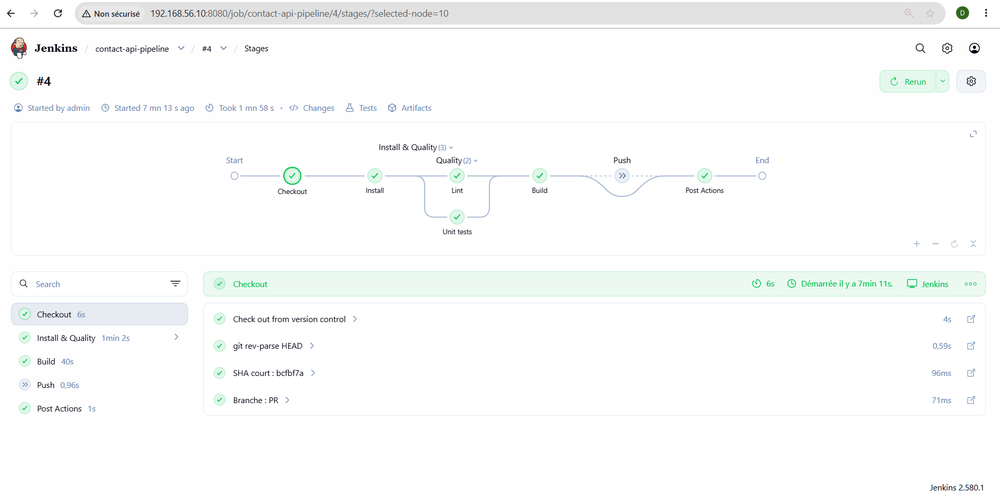
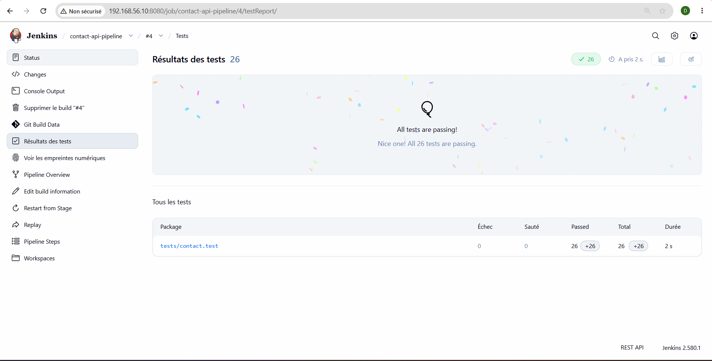
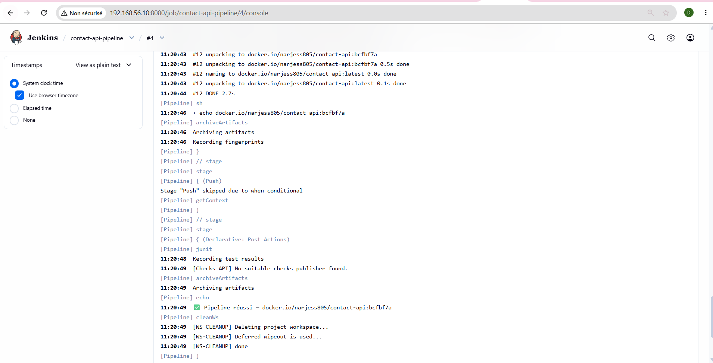
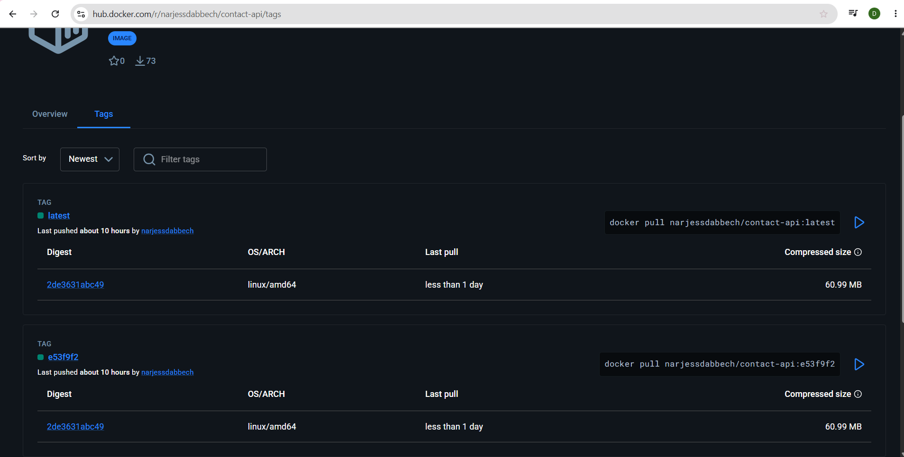
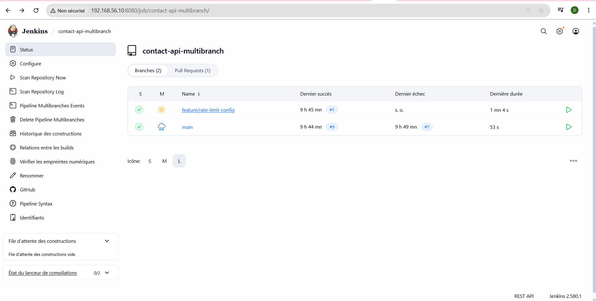

# TP9 — Pipeline as Code avec Jenkins

Pipeline déclaratif Jenkins pour l'API `contact-api` (TP8) : agents Docker éphémères, stages parallèles, rapport JUnit, credentials Docker Hub masqués, image tagguée par Git SHA, Multibranch Pipeline GitHub.

## 📋 Sommaire
1. [Architecture du pipeline](#1-architecture-du-pipeline)
2. [Captures d'écran](#2-captures-décran)

---

## 1. Architecture du pipeline

Le pipeline s'exécute en 4 étapes principales :
- **Checkout** : Récupération du code et calcul du SHA court.
- **Install & Quality** : Exécution de `npm ci`, puis en **parallèle** le `Lint` et les `Unit tests` (dans un conteneur `node:24-alpine`).
- **Build** : Construction de l'image Docker tagguée avec le SHA.
- **Push** : Connexion sécurisée à Docker Hub et push de l'image (uniquement sur la branche `main`).

## 2. Captures d'écran

### Vue des stages (Lint et Unit tests en parallèle)

### Rapport JUnit (13 tests réussis)

### Token Docker Hub masqué (****)

### Tag Git SHA sur Docker Hub

### Multibranch Pipeline (main + feature + PR)

