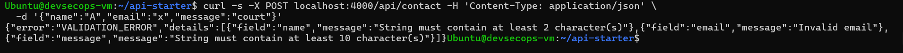
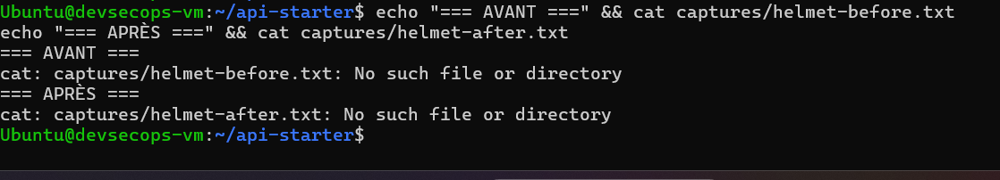
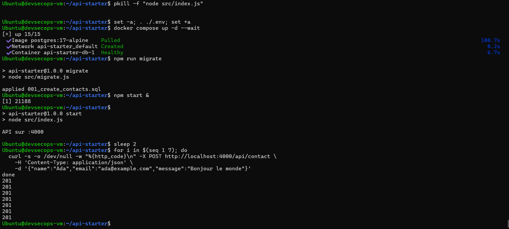
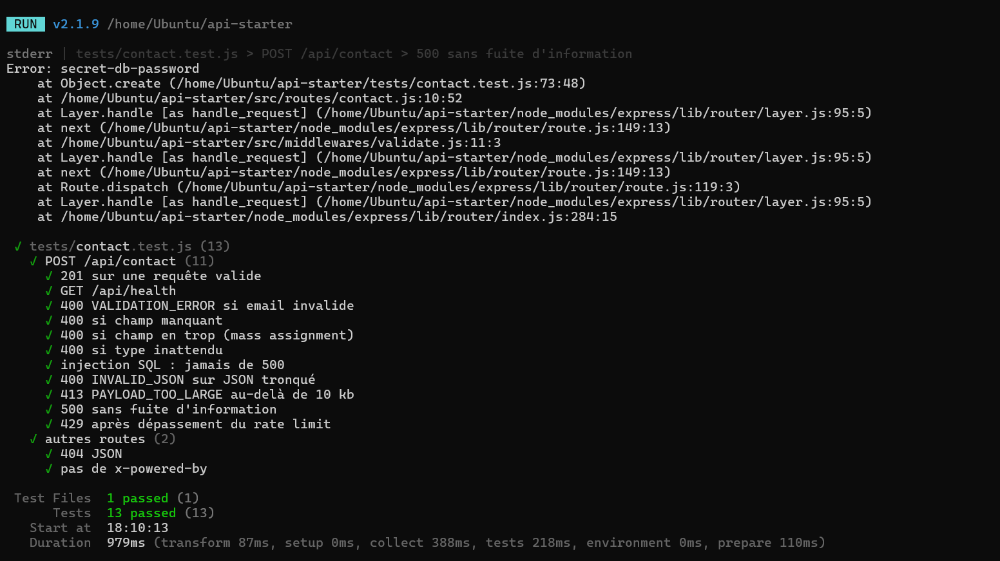
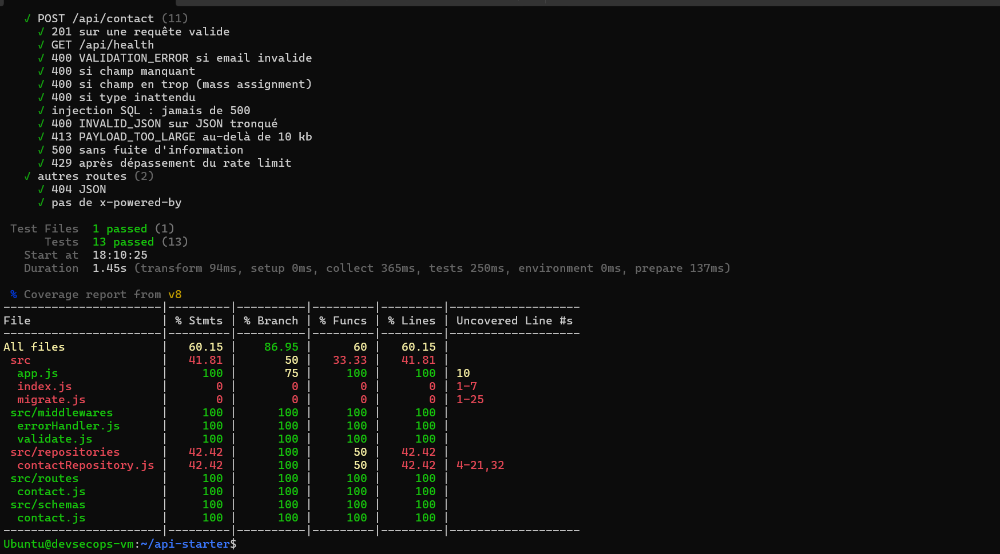
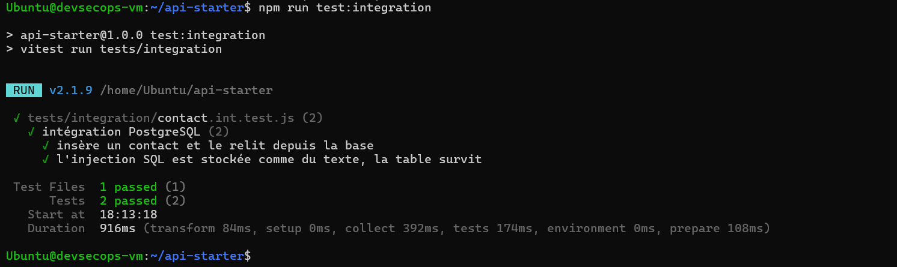

# TP8 — API Express sécurisée et testée (Zod, Helmet, rate limiting, Vitest)

API de formulaire de contact volontairement fragile, durcie (validation Zod, Helmet, limitation de taille et de débit, erreurs centralisées), puis validée par des tests automatisés (Vitest + Supertest) et un test d'intégration contre PostgreSQL lancé avec Docker Compose.

## Sommaire

- [Démarrage rapide](#démarrage-rapide)
- [Structure du projet](#structure-du-projet)
- [Analyse OWASP API Security Top 10](#analyse-owasp-api-security-top-10)
- [Validation et gestion des erreurs](#validation-et-gestion-des-erreurs)
- [Durcissement HTTP](#durcissement-http)
- [Tests de routes et cas négatifs](#tests-de-routes-et-cas-négatifs)
- [Migrations et intégration PostgreSQL](#migrations-et-intégration-postgresql)
- [Livrables](#livrables)

---

## Démarrage rapide

```bash
npm install
npm test                                  # tests de routes (repository en mémoire)

cp .env.example .env                      # puis changer PGPASSWORD
set -a; . ./.env; set +a
docker compose up -d --wait               # PostgreSQL 17
npm run migrate                           # applique les migrations
npm run test:integration                  # test contre le vrai PostgreSQL
npm start                                 # API sur :4000
```

---

## Structure du projet

```
api-starter/
├── .env.example
├── .gitignore
├── compose.yaml                  PostgreSQL 17-alpine
├── package.json
├── migrations/
│   ├── 001_create_contacts.sql
│   └── 002_add_contacts_email_index.sql
├── src/
│   ├── app.js                    createApp({ contactRepository, rateLimitMax })
│   ├── index.js                  démarrage du serveur
│   ├── migrate.js                applique les migrations (idempotent)
│   ├── middlewares/
│   │   ├── validate.js           validation Zod → 400 VALIDATION_ERROR
│   │   └── errorHandler.js       erreurs centralisées, sans stack trace
│   ├── repositories/
│   │   └── contactRepository.js  PostgreSQL (requêtes paramétrées) + mémoire
│   ├── routes/contact.js
│   └── schemas/contact.js        schéma Zod strict
├── tests/
│   ├── contact.test.js           Vitest + Supertest
│   └── integration/contact.int.test.js
└── captures/
```

---

## Analyse OWASP API Security Top 10

| Risque OWASP (2023) | Concerne notre API ? | Mesure dans ce TP |
|---|---|---|
| API1 Broken Object Level Authorization | Non (aucun objet rattaché à un utilisateur) | Authentification à prévoir si une liste est exposée |
| API2 Broken Authentication | Partiellement : `POST` public voulu | Hors périmètre du TP |
| API3 Broken Object Property Level Authorization | Oui (mass assignment) | `.strict()` refuse les champs en trop |
| API4 Unrestricted Resource Consumption | Oui | Rate limiting, corps limité à 10 kb |
| API5 Broken Function Level Authorization | Non (pas de rôles) | n/a |
| API6 Unrestricted Access to Sensitive Business Flows | Oui (spam du formulaire) | Rate limiting par IP |
| API7 Server Side Request Forgery | Non (aucune requête sortante) | n/a |
| API8 Security Misconfiguration | Oui | Helmet, pas de stack trace, pas de `x-powered-by` |
| API9 Improper Inventory Management | Faible | Une seule version, route 404 JSON |
| API10 Unsafe Consumption of APIs | Non | n/a |

### Trois attaques que la version de départ laissait passer

1. **Fuite d'informations** : une erreur renvoyait le message et la stack trace au client (API8).
2. **Entrées arbitraires** : champs en trop, types inattendus, corps de taille illimitée (API3, API4).
3. **Spam / déni de service** : aucune limite de débit sur le formulaire (API4, API6).

L'injection SQL était déjà bloquée par les requêtes paramétrées (`$1, $2, $3`) du repository.

---

## Validation et gestion des erreurs

Chaîne de middlewares : `helmet` → `rate limit` → `json (10 kb)` → `validate` → route → `404` → `errorHandler`.

- **Schéma Zod `.strict()`** : `name` (trim, 2–100), `email` (format email, ≤ 254), `message` (10–2000).
- **`validate`** : en cas d'échec, `400` avec :

```json
{
  "error": "VALIDATION_ERROR",
  "details": [{ "field": "email", "message": "Invalid email" }]
}
```

- **`errorHandler` centralisé** : `INVALID_JSON` (400), `PAYLOAD_TOO_LARGE` (413), `INTERNAL_ERROR` (500). La stack trace est journalisée côté serveur uniquement, jamais envoyée au client.
- **Route 404 JSON** : `{ "error": "NOT_FOUND" }`.



---

## Durcissement HTTP

| Mesure | Implémentation |
|---|---|
| Pas de `X-Powered-By` | `app.disable("x-powered-by")` |
| Headers de sécurité | `app.use(helmet())` |
| Taille du corps | `express.json({ limit: "10kb" })` |
| Rate limiting | `express-rate-limit` sur `/api/contact` : 5 requêtes / minute / IP, headers `RateLimit-*` |
| Reverse proxy | `trust proxy` activé via la variable `TRUST_PROXY` |

Comparaison des headers avant / après Helmet (`curl -I http://localhost:4000/api/health`) :



Test du rate limit (7 requêtes valides consécutives) :

```bash
for i in $(seq 1 7); do
  curl -s -o /dev/null -w "%{http_code}\n" -X POST http://localhost:4000/api/contact \
    -H 'Content-Type: application/json' \
    -d '{"name":"Ada","email":"ada@example.com","message":"Bonjour le monde"}'
done
```

Résultat : `201` × 5 puis `429` × 2.



---

## Tests de routes et cas négatifs

Les tests de routes utilisent **Supertest** (pas de port ouvert) et un **repository en mémoire** à la place de PostgreSQL : rapides et sans dépendance.

| Test | Résultat attendu |
|---|---|
| Requête valide | `201` |
| `GET /api/health` | `200` |
| Email invalide | `400 VALIDATION_ERROR`, champ `email` |
| Champ manquant | `400 VALIDATION_ERROR` |
| Champ en trop (mass assignment) | `400` |
| Type inattendu (`name: 42`) | `400` |
| Tentative d'injection SQL | jamais de `500` |
| JSON tronqué | `400 INVALID_JSON` |
| Corps > 10 kb | `413 PAYLOAD_TOO_LARGE` |
| Repository qui lève une exception | `500 INTERNAL_ERROR`, sans stack ni message d'origine |
| Dépassement du rate limit | `429` |
| Route inconnue | `404 NOT_FOUND` |
| Header `x-powered-by` | absent |

**Résultat : 13 tests passés, aucun `todo`.**



> Le bloc `stderr` visible pendant le test « 500 » est normal : c'est la stack trace journalisée côté serveur par l'`errorHandler`, qui n'est jamais renvoyée au client.

### Couverture

```bash
npm run test:coverage
```

| Fichier | Lignes |
|---|---|
| `app.js`, `validate.js`, `errorHandler.js`, `routes/contact.js`, `schemas/contact.js` | **100 %** |
| `contactRepository.js` | 42 % (partie PostgreSQL couverte par le test d'intégration) |
| `index.js`, `migrate.js` | 0 % (démarrage et script de migration) |
| **Global** | **60,15 % des lignes, 86,95 % des branches** |

Toute la logique de l'API est couverte à 100 %. Le global est tiré vers le bas par des fichiers qu'un test de routes n'exerce pas.



---

## Migrations et intégration PostgreSQL

- `001_create_contacts.sql` : table `contacts`.
- `002_add_contacts_email_index.sql` : index sur `email`.
- `npm run migrate` est **idempotent** : une table `schema_migrations` mémorise les fichiers appliqués, une seconde exécution affiche `skip 001…`, `skip 002…`.

```sql
CREATE INDEX IF NOT EXISTS idx_contacts_email ON contacts (email);
```

Le test d'intégration (`tests/integration/contact.int.test.js`) :
- insère un contact via l'API puis le relit directement dans PostgreSQL ;
- envoie une injection SQL et vérifie qu'elle est stockée comme du texte et que la table survit.

```bash
npm run test:integration
```

Résultat : <à remplir avec ta sortie réelle, ex. 2 tests passés>



---

## Livrables

| Élément | État |
|---|---|
| Code complété (schéma, `validate`, `errorHandler`, `app.js`, tests) | ✅ |
| Migration `002_add_contacts_email_index.sql` | ✅ |
| Tableau OWASP | ✅ |
| `captures/validation-400.png` | ⬜ |
| `captures/helmet-headers.png` | ⬜ |
| `captures/rate-limit-429.png` | ⬜ |
| `captures/tests-ok.png` | ⬜ |
| `captures/coverage.png` | ⬜ |
| `captures/integration-ok.png` | ⬜ |

*(passer à ✅ uniquement ce qui est réellement dans le dépôt)*

---

## Auteur

- **Nom** : <ton nom>
- **Formation** : <ta formation>
- **Année** : 2025–2026
